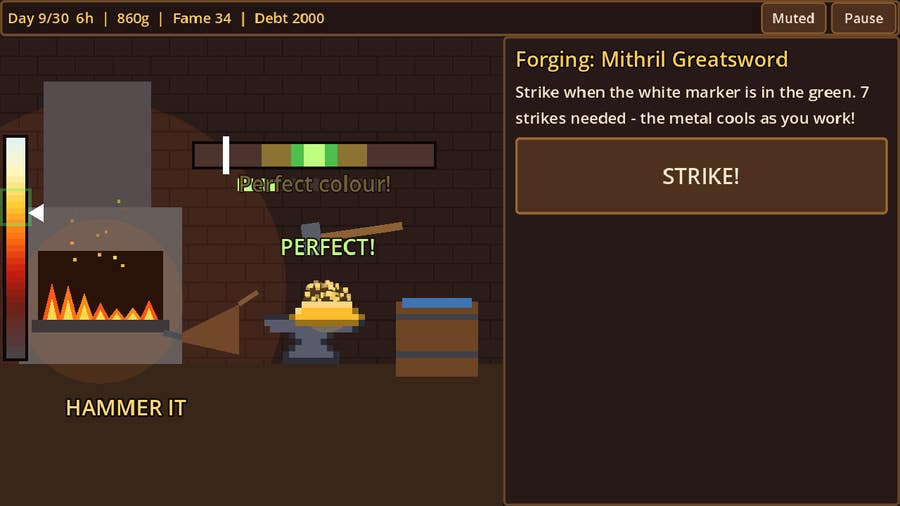
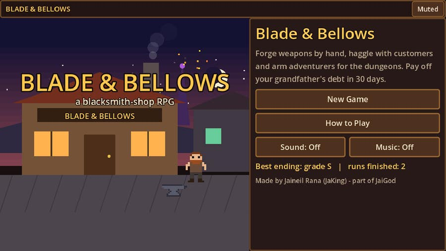
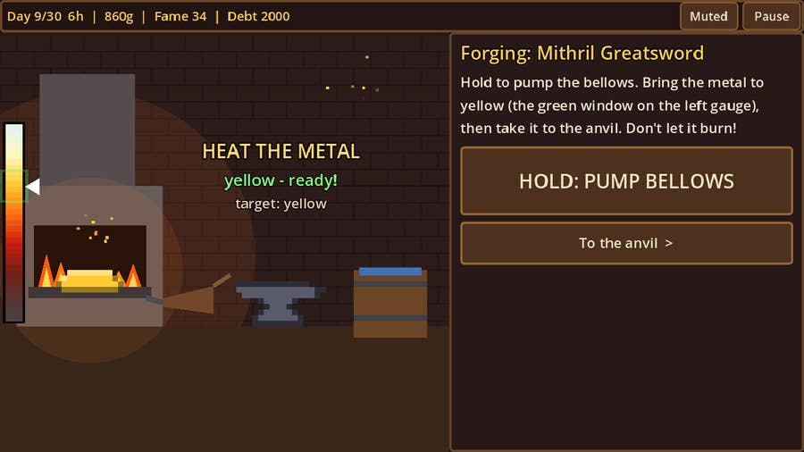
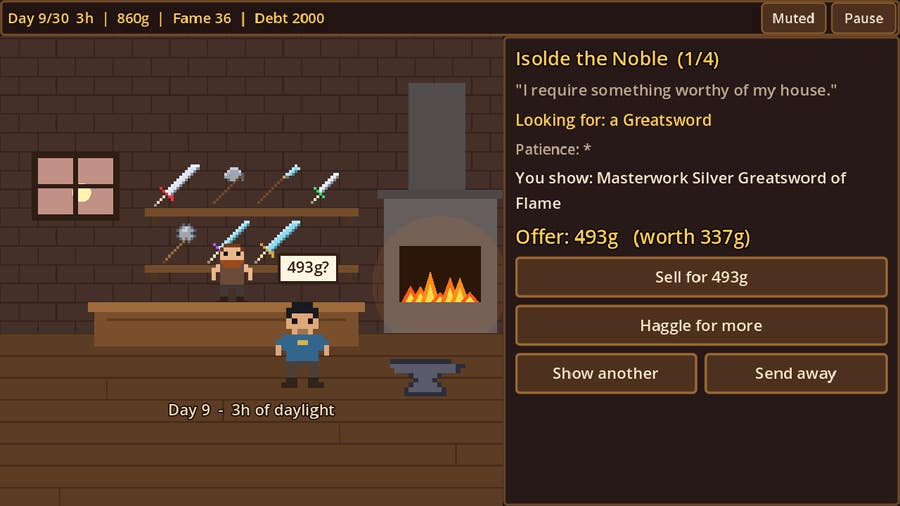
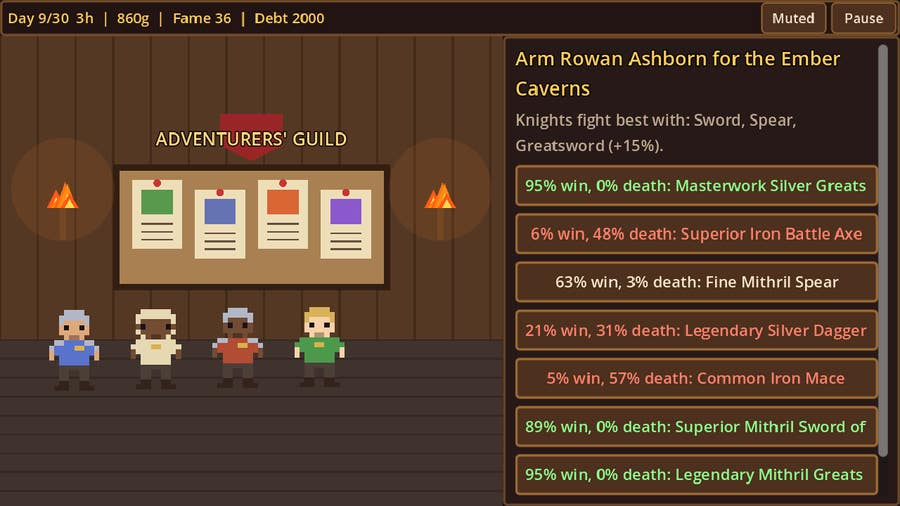
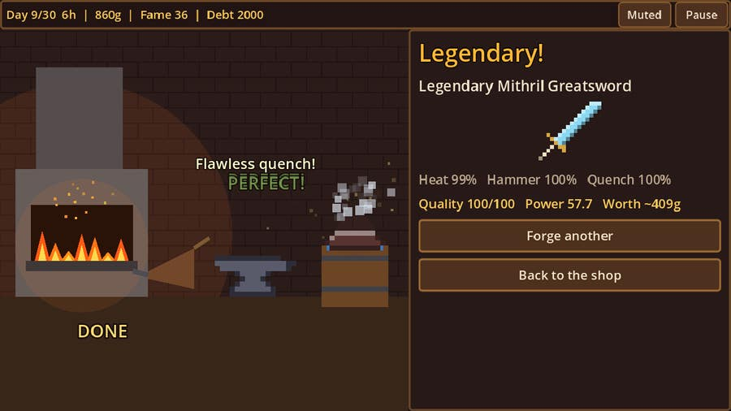
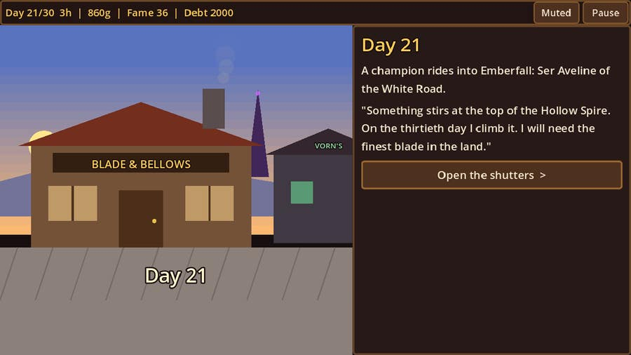
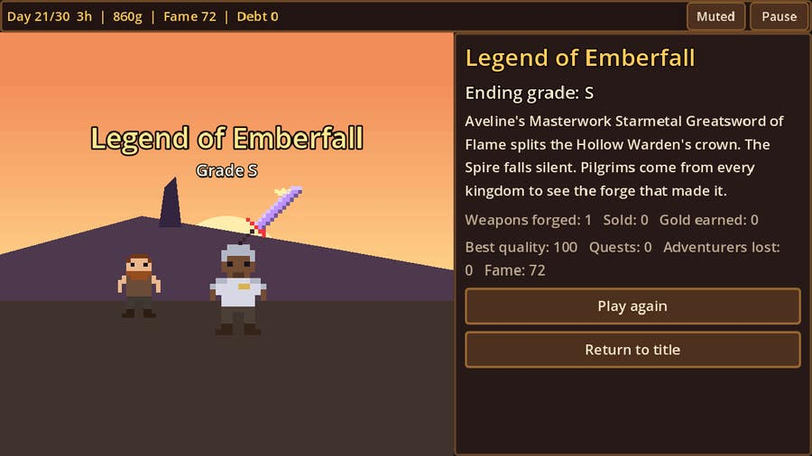
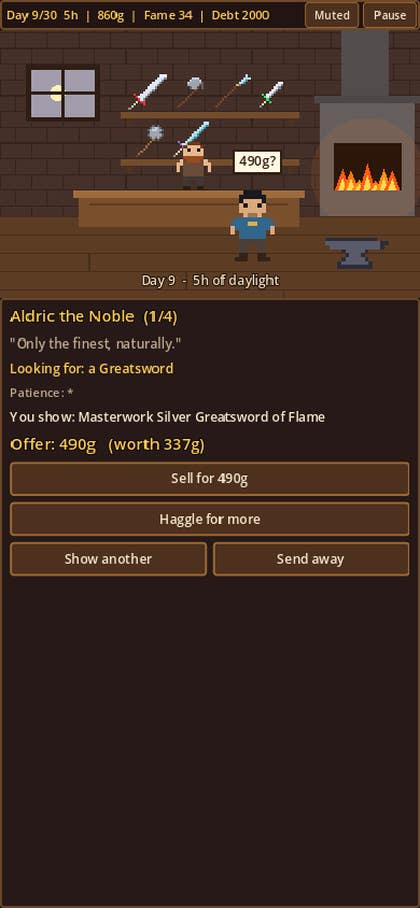

<div align="center">

# ⚒️ Blade & Bellows

### A pixel-art blacksmith-shop RPG made in Godot 4

**Forge weapons by hand · haggle with customers · arm adventurers · pay off the debt in 30 days**

[](https://jaigod.github.io/blade-and-bellows/play/)

[](https://jaigod.github.io/blade-and-bellows/)
[](https://godotengine.org)
[](https://github.com/JaiGod/blade-and-bellows/actions/workflows/pages.yml)
[](LICENSE)
[](https://github.com/JaiGod)



</div>

---

## 📖 The story

Your grandfather's forge in **Emberfall** is yours now, and so is his **2,000-gold debt** to Guildmaster Hesk, due in **30 days**.
Across the square, rival smith **Vorn Ashgrave** is ready to undercut you, sabotage you and beat you at the town contests.
On day 21 a champion arrives with a request: *forge the finest blade in the land before she climbs the Hollow Spire.*

## 🎮 Play

| | |
|---|---|
| ▶ **Play the game** | **https://jaigod.github.io/blade-and-bellows/play/** |
| 🏠 Landing page | https://jaigod.github.io/blade-and-bellows/ |
| 🧪 CI screenshots (fresh every deploy) | https://jaigod.github.io/blade-and-bellows/shots/title.jpg |
| 🛠️ Builds | [GitHub Actions](https://github.com/JaiGod/blade-and-bellows/actions) |

Works on desktop (keyboard + mouse) and phones (touch, portrait or landscape). Progress saves automatically.

## 📸 Screenshots

| Title | Heat the metal | Hammer it |
|---|---|---|
|  |  |  |
| **Haggling in the shop** | **Adventurers' Guild** | **A Legendary result** |
|  |  |  |
| **Story mornings** | **An ending** | **Mobile** |
|  |  |  |

## ✨ Features

- 🔥 **Hands-on forging minigame** in three phases:
  1. **Heat**: hold to pump the bellows until the metal glows the right colour for its ore (cherry red for copper up to white-hot for starmetal). Overheat it and it scorches.
  2. **Hammer**: strike as the marker swings through the sweet spot. Perfect hits throw sparks and shake the screen, and the metal cools while you work.
  3. **Quench**: plunge the blade as its glow fades into the window.
- ⚔️ **6 weapon types** (Dagger, Sword, Battle Axe, Spear, Mace, Greatsword) × **5 ores** (Copper, Iron, Silver, Mithril, Starmetal) × **4 fittings** (Oak, Leather, Wyrmbone, Ebonwood).
- 🏅 **6 quality tiers**: Crude, Common, Fine, Superior, Masterwork, Legendary.
- 💎 **Gem enchanting**: Ruby *Flame*, Sapphire *Frost*, Emerald *Fortune*, Topaz *Haste*, Amethyst *Warding*.
- 💰 **Haggling customers** with personalities: Hagglers, Nobles, Veterans, Apprentices, Collectors and Bards, each with a budget, a wanted weapon and limited patience.
- 🗡️ **Adventurers & 4 dungeons**: lend weapons to Knights, Rogues, Barbarians, Rangers and Clerics. They raid the Mossy Warrens, Sunken Crypt, Ember Caverns or Hollow Spire and come back with gold, ore, gems, fame and tales, **or die if your gear was bad**. Odds are shown before you send them.
- 🏗️ **Upgrades**: Forge (heat window, cooling, new ores), Anvil (sweet spot, swing speed) and Shop (customers, prices, fittings).
- 😈 **Rival events**: price war, coal sabotage, adventurer poaching, rumours and two smithing contests against Vorn.
- 📅 **30-day story** with weekly rent, a debt deadline, random town events (dwarven caravans, gem peddlers, market days, storms) and **4 endings** graded S to F.
- 🎨 **All art and audio made in code**: pixel sprites defined as text grids, procedural anvil clangs, quench hiss, bellows whoosh and a synthesized lute loop.
- 💾 Saves to `user://` (IndexedDB in the browser), pause menu, sound and music toggles.

## 🕹️ Controls

| Action | Keyboard / mouse | Touch |
|---|---|---|
| Pump the bellows | Hold **Space**, the big button, or hold the scene | Hold the button or the scene |
| Take metal to the anvil | **Enter** or "To the anvil" | Tap "To the anvil" |
| Strike / quench | **Space** or click | Tap |
| Pause | **Esc** or "Pause" | Tap "Pause" |

## 🧰 Tech stack

- **Godot 4.3** (GDScript), Compatibility renderer (WebGL 2), Web export with threads off so it runs on GitHub Pages without special headers.
- **GitHub Actions** with `barichello/godot-ci:4.3`: headless smoke test → Web export → screenshots under Xvfb → GitHub Pages deploy.
- No external assets: every sprite, sound and the music are generated at runtime.

## 📁 Project structure

| Path | What it does |
|---|---|
| [`scripts/data.gd`](scripts/data.gd) | Ores, fittings, weapon types, tiers, gems, customers, dungeons, story beats |
| [`scripts/game.gd`](scripts/game.gd) | Autoload with all rules: economy, haggling, quests, events, endings, save/load |
| [`scripts/forge_sim.gd`](scripts/forge_sim.gd) | The heat → hammer → quench minigame as pure, testable logic |
| [`scripts/main.gd`](scripts/main.gd) | Responsive UI: every screen, input, pause, shop and guild flows |
| [`scripts/view.gd`](scripts/view.gd) | Draws the shop, forge, guild, street and ending scenes with particles and shake |
| [`scripts/pix.gd`](scripts/pix.gd) | Pixel art as text grids, baked into textures |
| [`scripts/sfx.gd`](scripts/sfx.gd) | Procedural sound effects and music |
| [`tests/`](tests) | Headless smoke test and the screenshot capture scene |
| [`web/index.html`](web/index.html) | The landing page at `/` |
| [`.github/workflows/pages.yml`](.github/workflows/pages.yml) | Test, export and deploy pipeline |

## 🚀 Run locally

```bash
git clone https://github.com/JaiGod/blade-and-bellows.git
cd blade-and-bellows
godot --path .                                     # play in the editor build
godot --headless --path . res://tests/Smoke.tscn   # run the smoke test (prints SMOKE OK)
godot --headless --path . --export-release "Web" build/play/index.html
cd build && python3 -m http.server 8000            # open http://localhost:8000/play/
```

## 🛠️ Development log

- **Design: the forge is the game.** Every weapon you sell comes from the minigame, so it had to feel physical. Heat colours follow real blacksmith glow names, each ore wants a different colour, and hammer strikes get faster as you go. Score = 30% heat + 50% hammer + 20% quench.
- **Design: risk you can read.** Adventurer odds (win % and death %) are shown on every weapon before you commit, and class-favoured weapons give +15%. Bad steel getting someone killed should feel like *your* fault, not luck.
- **Design: one responsive layout.** The scene draws on a 160×100 virtual pixel canvas that scales to any size. Landscape puts the menu beside it, portrait stacks it below, and the forge view grows taller on phones.
- **Challenge: testability.** Rules live in `game.gd` and `forge_sim.gd` with no rendering, so the headless smoke test can play perfect and sloppy forges, sell with haggling, run quests, contests, 30 days and every ending in CI.
- **Fix:** overlapping feedback text in the hammer phase. Strike results now only appear as floating text above the anvil.
- **Fix:** a noble paying 160% of value felt broken, so wanted-type bonuses and noble generosity were toned down.
- **Fix:** the screenshot script could capture before the forge had finished. It now strikes until the phase actually changes.
- **Balance:** the champion's blade needs strength 80 (blade power + 20 + fame/10). Getting there takes a Masterwork mithril greatsword or anything starmetal, so upgrades matter.
- **Beta tested on the live site ✅ (2026-11-06):** title → new game → forge → shop on the live GitHub Pages build, no console errors, canvas rendering.

## 🔗 More JaiGod games

- [Iron Oath Tactics](https://github.com/JaiGod/iron-oath-tactics): turn-based fantasy tactics
- [Runebound Saga](https://github.com/JaiGod/runebound-saga) · [Ember Crypt](https://github.com/JaiGod/ember-crypt) · [The Hollow Between](https://github.com/JaiGod/the-hollow-between)
- [Harvest Hollow](https://github.com/JaiGod/harvest-hollow) · [Moonfarm](https://github.com/JaiGod/moonfarm) · [Arcane Deck](https://github.com/JaiGod/arcane-deck)
- 👉 All games: **[github.com/JaiGod](https://github.com/JaiGod)**

---

<div align="center">

Made by Jaineil Rana (JaKing) · part of [JaiGod](https://github.com/JaiGod)

</div>
